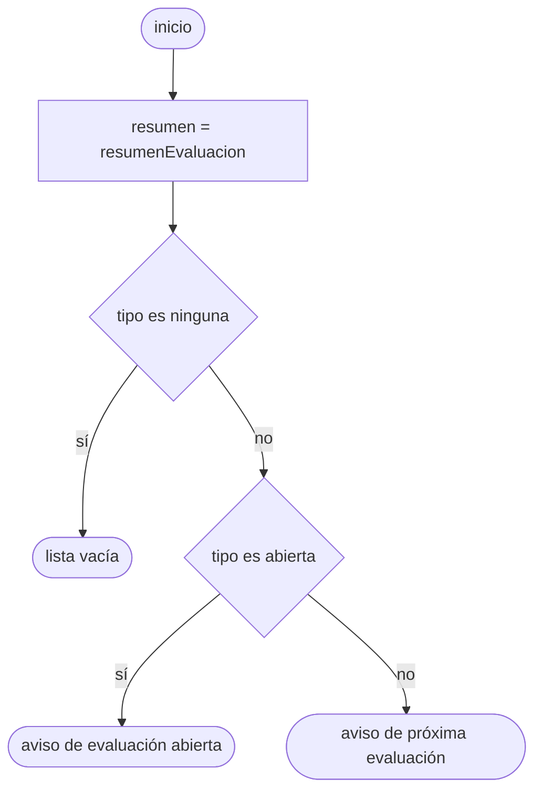
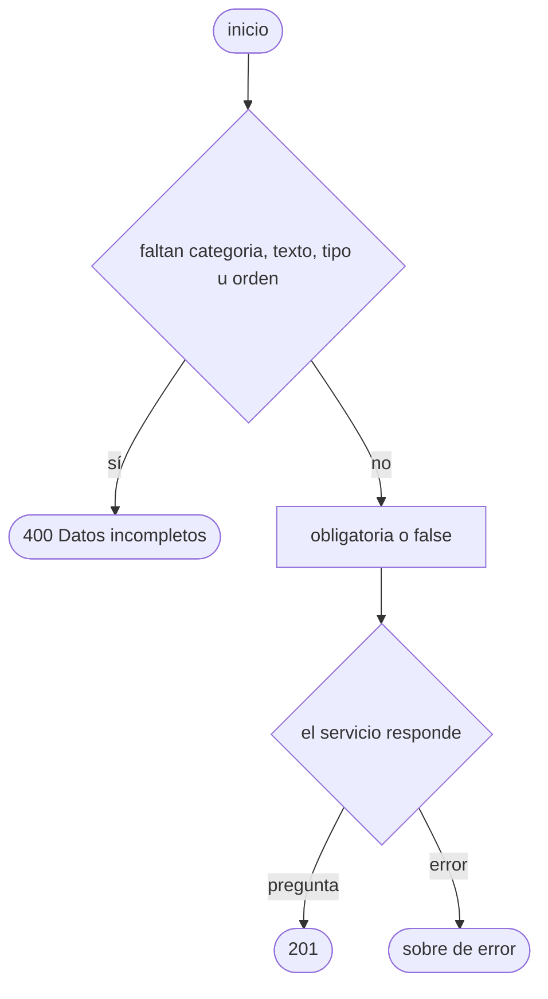

# 5. Caja blanca y caja negra

| Campo | Valor |
|---|---|
| Proyecto | EntreAulas |
| Integrante | Esteban Arias |
| Alcance | RF-ENC-32, RF-ENC-33, RF-NOT-34, RF-NOT-35 |
| Medición | 16 de noviembre de 2026, `scripts/complejidad-ciclomatica.mjs` |

V(G) = decisiones + 1. El script cuenta `if`, bucles, `case`, `catch`, `?:`, `&&`, `||` y `??`. Una comparación suelta (`<=`, `===`) no suma una decisión.

## 1. Caja blanca

### 1.1 Funciones del alcance

| Archivo | Función | V(G) | Riesgo |
|---|---|---|---|
| `notificaciones.ts` | `accionAbierta` | 3 | Bajo |
| `notificaciones.ts` | `notificacionesDeEvaluacion` | 3 | Bajo |
| `calendario.ts` | `resumenEvaluacion` | 3 | Bajo |
| `calendario.ts` | `textoDias` | 3 | Bajo |
| `evaluations.service.ts` | `createQuestion` | 3 | Bajo |
| `evaluations.service.ts` | `updateQuestion` | 2 | Bajo |
| `evaluations.service.ts` | `deactivateQuestion` | 2 | Bajo |
| `evaluations.controller.ts` | `createQuestion` | 7 | Moderado |
| `evaluations.controller.ts` | `updateQuestion` | 3 | Bajo |
| `evaluations.controller.ts` | `deactivateQuestion` | 4 | Bajo |

Ninguna pasa de 10. La más alta es el alta HTTP de la pregunta, por el `if` con tres `||`, el `||` de `obligatoria` y el `catch`.

`estadoDelDia` en `calendario.ts` mide V(G) = 6. Marca los días del calendario y no arma el texto de la campana. La campana usa `resumenEvaluacion`.

### 1.2 `notificacionesDeEvaluacion` — grafo y caminos

Decisiones: dos `if`. V(G) = 3.

| Camino | Condición | Caso |
|---|---|---|
| 1 | `tipo === 'ninguna'` | Sin ventanas, o todas ya cerradas, devuelve `[]` |
| 2 | `tipo === 'abierta'` | Aviso «Evaluación docente abierta». `urgente` es verdadero si `diasRestantes <= 2` |
| 3 | otro tipo | Aviso «Próxima evaluación docente», nunca urgente y sin acción |

`accionAbierta` tiene sus tres caminos aparte: estudiante → «Evaluar ahora»; admin → sin acción; cualquier otro rol → «Ver reportes».

### 1.3 `createQuestion` del controlador — grafo y caminos

El script cuenta cada `||` del `if`, el `||` de `obligatoria` y el `catch`, y por eso V(G) = 7. Los cuatro huecos del `if` son el mismo resultado para quien llama: 400. Un solo caso negativo recorre el primer `||`; los otros tres `||` quedan en la misma clase y no tienen un caso cada uno.

| Camino observable | Caso que lo ejecuta |
|---|---|
| Falta un campo obligatorio | «rechaza el alta si faltan los campos» |
| Datos completos y el servicio responde | «crea la pregunta y confirma con 201» |
| El servicio lanza | «si el servicio falla, no confirma el alta» |
| `obligatoria` ausente o verdadera | Los dos casos del servicio: por defecto `false` y `activa: true`; si llega `true`, se conserva |

`updateQuestion` (V(G) = 3): sin id → 400; con id y servicio ok → 200; el servicio lanza → sobre de error.

`deactivateQuestion` (V(G) = 4): sin id → 400; el servicio devuelve `true` → confirmación; devuelve `false` → 500; el `catch` envuelve cualquier error ya lanzado, incluido ese 500.

## 2. Caja negra

No se mira el grafo. Se eligen clases de datos y se observa la salida.

### 2.1 Particiones de la pregunta (RF-ENC-32 y RF-ENC-33)

| Clase | Entrada | Salida esperada | Prueba |
|---|---|---|---|
| Válida, obligatoria omitida | Categoría, texto, tipo y orden | Se guarda activa y no obligatoria | Servicio y pantalla |
| Válida, obligatoria | Los mismos campos y obligatoria en verdadero | Se conserva obligatoria | Servicio |
| Inválida | Texto solo con espacios, o falta un campo | No se guarda; en HTTP, 400 | Pantalla y controlador |
| Corrección válida | Id y campos nuevos | La actualización usa ese id | Servicio y controlador |
| Retiro válido | Id de una pregunta activa | Deja de ofrecerse | Servicio, controlador y pantalla |
| Retiro imposible | El almacén responde falso o lanza | No se confirma; la fila sigue en la tabla | Servicio, controlador y pantalla |
| Sin identificador | Alta de corrección o retiro sin id | 400, no se llama al cambio | Controlador |

### 2.2 Particiones y límites de la ventana (RF-NOT-34 y RF-NOT-35)

Ventana de referencia: 28 de septiembre de 2026 a 9 de octubre de 2026.

| Clase | Fecha que ejecutó la prueba | Salida |
|---|---|---|
| Sin ventana | 3 de octubre, lista vacía | Ningún aviso |
| Antes de abrir | 25 de septiembre | «Próxima evaluación docente», no urgente, sin acción |
| Abierta, lejos del cierre | 3 de octubre (faltan 6 días) | «Evaluación docente abierta», no urgente |
| Abierta y urgente | 8 de octubre (falta 1 día; el mensaje dice «cierra mañana») | El mismo título, urgente |
| Ya cerrada | 20 de octubre | Ningún aviso |

La condición del código es `diasRestantes <= 2`. El caso urgente que corrió es el de 1 día. No hay un caso en el día exacto del límite (7 de octubre, 2 días) ni en el día siguiente del lado no urgente (6 de octubre, 3 días). El 3 de octubre cubre la clase «abierta y no urgente». El día de cierre, 9 de octubre, sigue dentro de la ventana y tampoco tiene un caso propio.

| Rol | Acción en el aviso abierto |
|---|---|
| Estudiante | «Evaluar ahora» hacia `/evaluate/selection` |
| Admin | Sin acción |
| Docente u otro rol | «Ver reportes» hacia `/reports` |

En la campana, marcar todas como leídas escribe los id en `localStorage` bajo `notificaciones-leidas`. Si las fechas de la ventana cambian, el id del aviso cambia y vuelve a mostrarse como no leído.

## 3. Lectura conjunta

Los caminos de V(G) = 3 de la notificación están ejecutados: ninguna, abierta y próxima, más los tres roles. En el alta HTTP, la clase «falta un campo» está probada una vez; no hay un caso separado por cada `||`. El comportamiento observable es el mismo en los cuatro huecos. La complejidad moderada (7) cabe en esa clase y en los dos resultados del servicio: creado o error.
