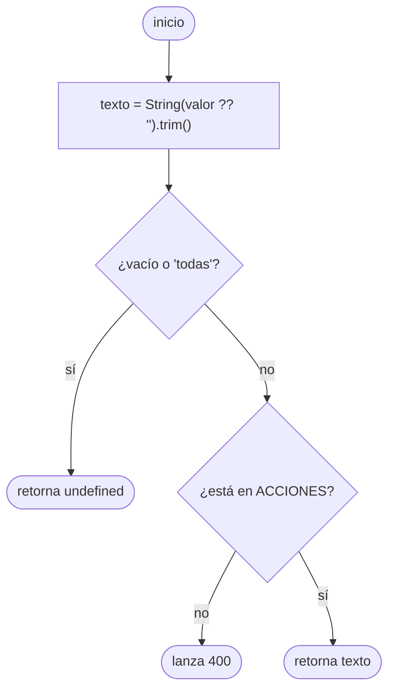
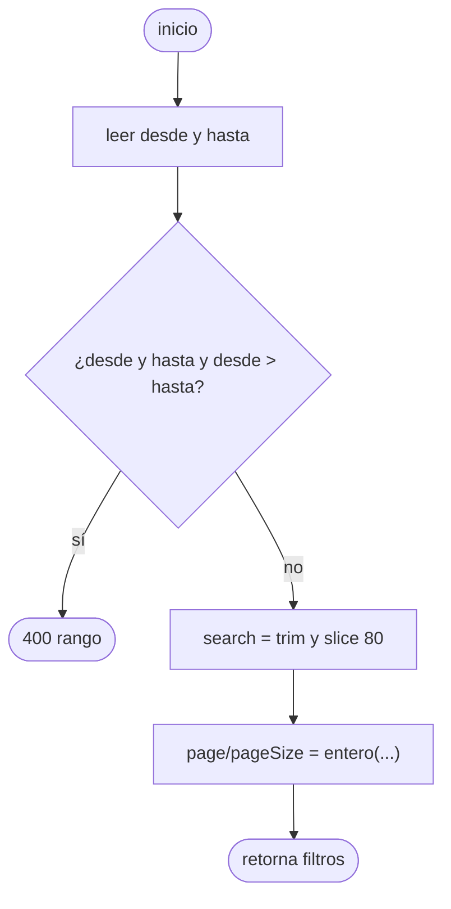

# Pruebas de caja blanca y caja negra

Código analizado: `auditoria.ts` y `auditoria.service.ts` (Back), `navegacion.ts`, `gestion-profesores.ts`, `preferencias.ts`, `auditoria.ts` del front y `AgendaEvaluaciones.tsx`.
Complejidad medida con `scripts/complejidad-ciclomatica.mjs` (compilador de TypeScript): V(G) = decisiones + 1 (`if`, bucles, `case`, `catch`, `?:`, `&&`, `||`, `??`). Tabla completa: [`evidencias/complejidad-ciclomatica.md`](evidencias/complejidad-ciclomatica.md).

## 1. Caja blanca

### 1.1 `leerAccion` (Back) — flujo, grafo, V(G)

```js
function leerAccion(valor) {
  const texto = String(valor ?? '').trim()                 // 1  (?? cuenta)
  if (!texto || texto === 'todas') return undefined        // 2  (if) 3 (||)
  if (!ACCIONES.includes(texto)) throw badRequest(...)     // 4  (if)
  return texto
}
```



Decisiones: `??`, `if`, `||`, `if` = 4 → **V(G) = 4 + 1 = 5** (coincide con la herramienta). Sobre el grafo simplificado de arriba (sin separar las condiciones compuestas) V = E − N + 2 = 8 − 7 + 2 = 3; la herramienta cuenta además cada operador lógico, que es la medida conservadora.
Caminos independientes y su caso de prueba:

| # | Camino | Entrada | Resultado | Prueba |
|---|---|---|---|---|
| 1 | vacío | `''` | `undefined` | `auditoria-logica` «"todas" o vacío no filtra» |
| 2 | `todas` | `'todas'` | `undefined` | ídem |
| 3 | `undefined` (rama `??`) | `undefined` | `undefined` | `parsearFiltrosAuditoria({})` |
| 4 | válida | `'generar_qr'` | `'generar_qr'` | `it.each(ACCIONES)` |
| 5 | inválida | `'borrar_todo'` | 400 | «rechaza una acción desconocida» y la de seguridad A03 |

### 1.2 `parsearFiltrosAuditoria` — V(G) = 6



Caminos: (1) sin fechas, (2) rango válido, (3) desde = hasta (límite), (4) rango invertido → 400, (5) fecha inválida → 400 (en `leerFecha`), (6) búsqueda > 80 → recorte. Todos con prueba (`it.each` de fechas inválidas y límites).

### 1.3 `cumpleFiltros` (V = 8) y `armarVistaAuditoria` (V = 4)

`cumpleFiltros` combina cuatro condiciones con `&&`/`||`. Se cubre cada condición verdadera y falsa por separado (acción, desde, hasta, búsqueda) → cobertura de condición/decisión. `armarVistaAuditoria`: caminos sin eventos, una página, página fuera de rango y varias páginas.

### 1.4 Front

| Función | V(G) | Caminos cubiertos |
|---|---|---|
| `estadoDelDocente` | 4 | sin evaluaciones, promedio < 4, = 4, > 4 (límites 3.99/4.0/4.01) |
| `rolDeNavegacion` | 7 | rol elegido, jerarquía, sinónimos (5), tipo desconocido, null |
| `rutaActiva` | 6 | exacta, prefijo más largo, subruta, prefijo falso (`/auditoria-x`) |
| `normalizarPreferencias` | 6 | vacío, no objeto (5 tipos), valores inválidos parciales |
| `celdaCsvSegura` | 4 | `=`, `+`, `-`, `@`, comas/comillas, normal, null |
| `situacionDeVentana` | 3 | próxima, abierta (inicio, medio, fin), cerrada |

### 1.5 Resultados y hallazgos
- Cobertura de líneas del código nuevo: **Back 97.6 %** (`auditoria.ts` 100 %, ramas 100 %); **Front 94.7 %** (ramas 82.6 %). Evidencia: `evidencias/cobertura-*.txt`.
- Ninguna función supera V(G) = 9 (límite recomendado 10). Las más altas: `cumpleFiltros` 8 → se simplificó en el refactor del TDD (de `if` en cadena a cuatro booleanos).
- Hallazgo de caja blanca: `registrarComoUsuario` (V = 9) mezcla lectura de usuario, de carrera y escritura; queda como candidata a dividir.
- Ramas sin cubrir: `auditoria.service.ts` líneas 63-64 (`catch` del `insert`) y 89-90 (error no-42P01 de `listar`); ambos quedan sin cubrir (se priorizó la ruta feliz y la degradación por tabla ausente).

## 2. Caja negra

### 2.1 Partición de equivalencia y valores límite

| Variable | Clases válidas | Clases inválidas | Valores límite probados |
|---|---|---|---|
| `pageSize` | 1–50 | ≤ 0, > 50, no numérico | 0, 1, 50, 51, 999, `abc` |
| `page` | ≥ 1 entero | ≤ 0, no numérico, decimal | 0, 1, 2.9 → 2, −1 |
| `accion` | 4 acciones, `todas`, vacío | cualquier otro texto, SQL, arreglos | cada válida + 4 maliciosas |
| `desde`/`hasta` | AAAA-MM-DD reales, vacío | `2026-13-01`, `2026-02-30`, `ayer`, formatos | `desde = hasta`, `desde > hasta` |
| `search` | 0–80 caracteres | > 80 | 80 y 120 → recorte |
| Promedio del docente | 4.0–5.0 (ok), 1.0–3.99 (riesgo) | 0 evaluaciones (sin datos) | 3.99, 4.0, 4.01 |
| Tamaño de letra | 4 niveles | valores manipulados | `9999`, `<b>` → ignorado |
| Idioma / tema | es, en · claro, oscuro, sistema | `fr`, texto libre | `fr` → es |

### 2.2 Escenarios (exitosos, alternativos y de error)

| Funcionalidad | Éxito | Alternativo | Error |
|---|---|---|---|
| Auditoría | Lista 10 de 23, resumen por acción | Filtros combinados, CSV, inglés | 401, 403 (4 roles), 400 filtros, tabla ausente (`disponible:false`), 500 |
| Gestión de profesores | Detalle del docente por periodo | Orden, filtros, móvil, `?profesor=` | Estadísticas 500, lista 500, sin resultados |
| Modo noche / idioma / letra | Cada opción se aplica y persiste | Automático según el sistema, 320 px | Preferencias manipuladas |
| Dashboard + calendario | Indicadores y fechas del mes | Menú móvil, «Hoy», periodo cerrado | API 500 (alerta / status) |

Cada fila tiene casos en [`MATRIZ-TRAZABILIDAD-FINAL.csv`](MATRIZ-TRAZABILIDAD-FINAL.csv). Hallazgos de caja negra: DEF-AUD-01, DEF-REDI-01…05 (ver `DEFECTOS.md`).
